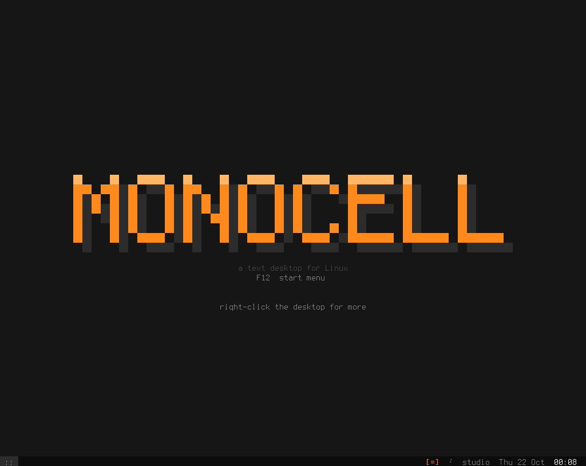
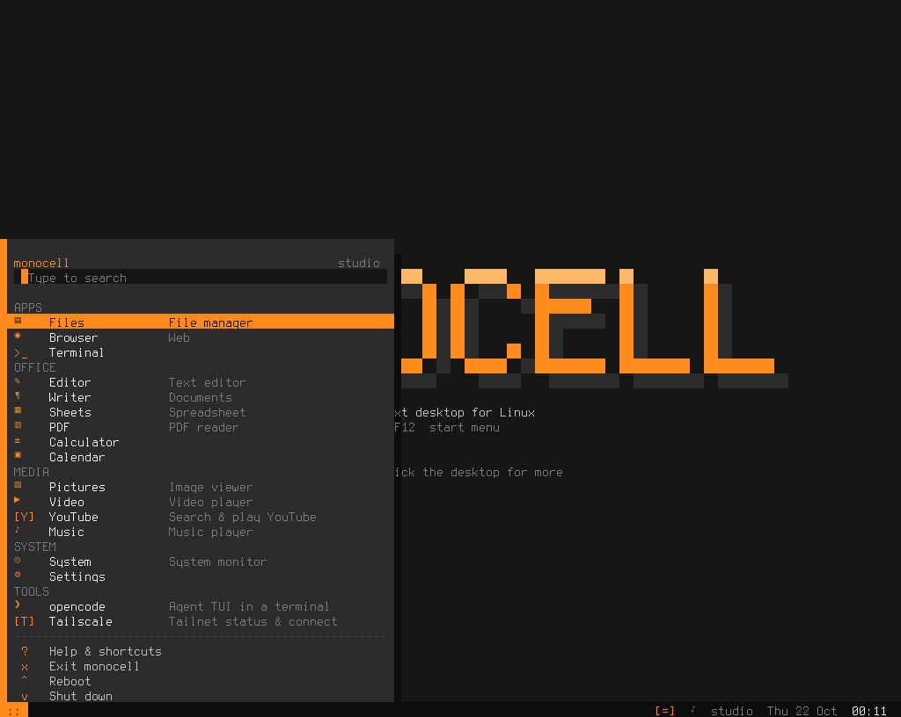
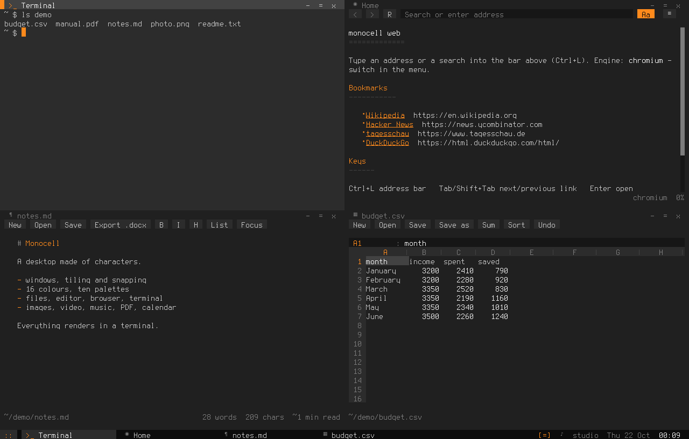
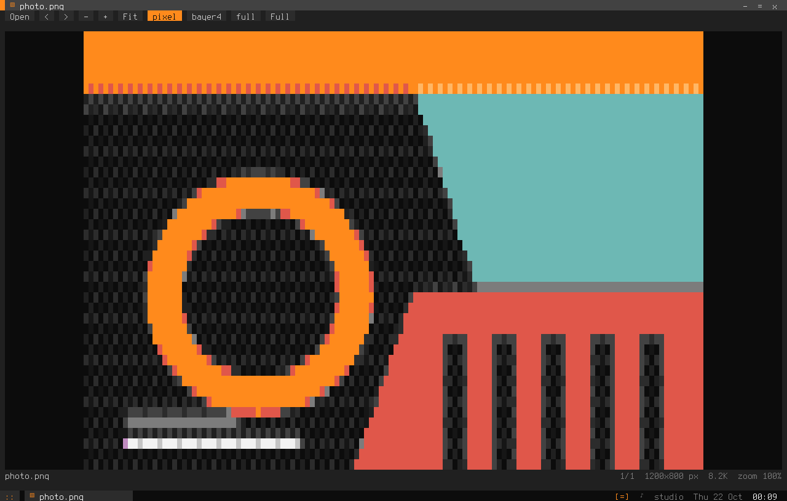
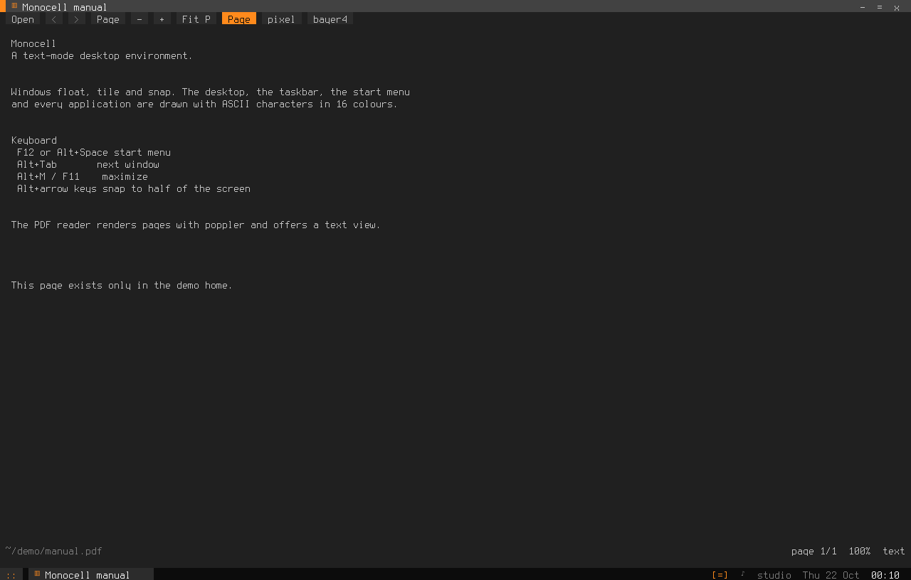
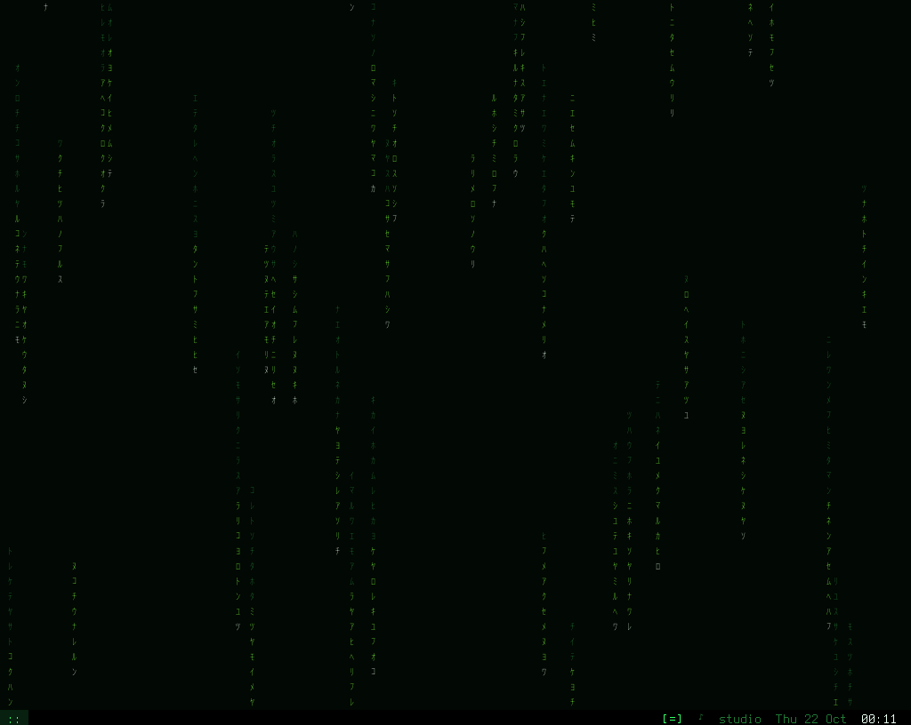
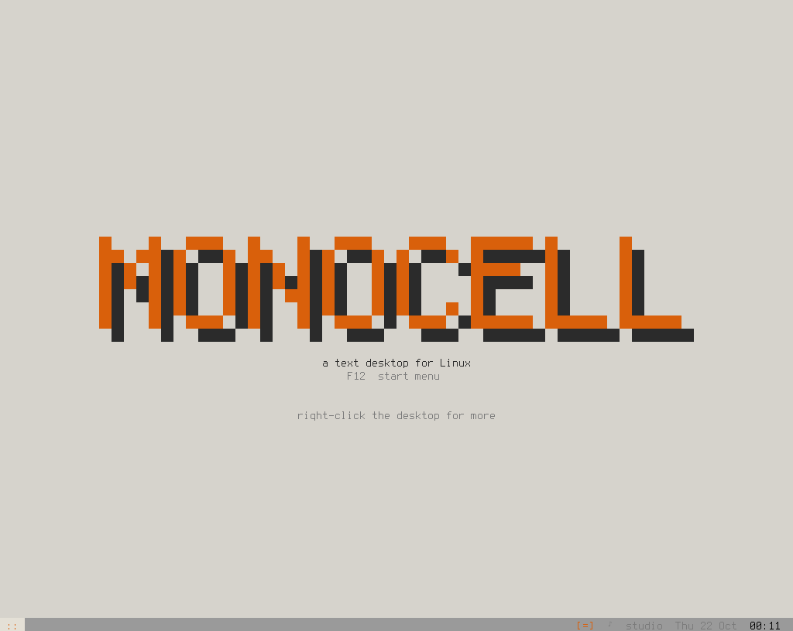

# Monocell

**Ein Text-Desktop für Linux.** Überlappende Fenster, Taskleiste, Startmenü und ein
Dutzend Anwendungen – gezeichnet mit nichts als ASCII-Zeichen in 16 Farben. Läuft in
jedem Terminal und auf der nackten Linux-Konsole (Kernel-VT), auch auf sehr schwacher
Hardware (getestet gegen ein ThinkPad X61s mit 1024×768).



| | |
|---|---|
|  |  |
|  |  |
|  |  |

*Screenshots aus dem Demo-Home, 120–160 Spalten. Die Fensterrahmen skalieren mit dem
Terminal; alles hier ist echte Ausgabe, keine Mockups.*

**Text-Screenshot:** `Alt+S` speichert den ganzen Bildschirm als Markdown-Datei
(Standard: `~/monocell-shots/`). Oben steht eine Klartext-Kopie (lesbar auf GitHub und in
jedem Editor), darunter eine eingeklappte Fassung mit 24-Bit-ANSI-Farben; `cat`, `bat`
oder `less -R` im Terminal zeigen damit die exakten Farben. GitHub rendert ANSI in
Repo-Dateien nicht. Beispiel: [screenshots/desktop-text.md](screenshots/desktop-text.md).

## Starten

```sh
cd ~/monocell
./run.sh                  # normal im Terminal
./run.sh --open files,terminal
./run.sh bild.jpg         # Datei mit passender App öffnen
```

Optionen: `--open files,terminal` (Apps beim Start), `--tile` (Fenster kacheln),
`--color auto|truecolor|palette|linux|ansi` (Farbausgabe erzwingen; sonst per
`MONOCELL_COLOR` oder Automatik), dazu Dateien/Ordner als Argumente.

Voraussetzungen: Python ≥ 3.9, ein UTF-8-fähiges Terminal. Optional, aber empfohlen:
`ffmpeg` (Bilder/Video/Ton), `Pillow` (schnellere Bildskalierung), `brave-browser` oder
`chromium` (JS-Webseiten), `pw-cat`/`pacat`/`aplay` (Ton), **poppler-utils**
(`pdftocairo`, `pdftoppm`, `pdftotext`, `pdfinfo` – PDF-Reader), `yt-dlp` (YouTube),
`opencode` (Agent-TUI, lokal oder per SSH auf einem anderen Rechner).

## Bedienung

Maus: Titelleiste ziehen = verschieben, an den Rand ziehen = andocken (oben = maximieren,
links/rechts = halbe Breite, Ecke = Viertel), Kanten/Ecken ziehen = Größe ändern,
Doppelklick auf den Titel = maximieren, Rechtsklick auf Titel/Taskleiste/Desktop = Menü.
**Mittlere Maustaste halten und ziehen** (auch mit dem Trackpoint) scrollt das Fenster
unter dem Zeiger – im Terminal durch den Scrollback, in Listen und Seiten.

| Taste | Wirkung |
|---|---|
| `F12` / `Alt+Space` | Startmenü (tippen filtert) |
| `Alt+Tab` / `Alt+P` | nächstes / vorheriges Fenster |
| `Alt+1…9` | Fenster N fokussieren |
| `Alt+Q` | Fenster schließen |
| `Alt+M` / `F11` | maximieren |
| `Alt+H` | minimieren |
| `Alt+D` | Desktop zeigen |
| `Alt+←/→` | halbe Breite andocken |
| `Alt+T` | alle Fenster kacheln |
| `Alt+Shift+Pfeile` | Größe ändern |
| `Ctrl+Alt+Pfeile` | verschieben |
| `Alt+Enter` | neues Terminal |
| `Alt+S` | Text-Screenshot als Markdown speichern |

Die Apps haben eigene Tasten (im Editor `Ctrl+S/O/F`, im Browser `Ctrl+L`, `Tab`,
`Alt+←`, `Ctrl+D`, `Ctrl+F`, in der Musik `Leertaste`, `n`/`p`, `←`/`→`, …).
`Hilfe & Tastenkürzel` im Startmenü zeigt das Wichtigste.

### Zwischenablage

* **Shift+Ziehen** markiert Text in jedem Fenster und kopiert ihn beim Loslassen
  (**Ctrl+Shift+Ziehen**: Rechteck). In Terminal und Editor markiert schon normales Ziehen.
* **Ctrl+Shift+C** kopiert, **Ctrl+Shift+V**, **Shift+Insert** oder ein **Mittelklick**
  fügen ein; **Rechtsklick** zeigt Kopieren/Einfügen. Das funktioniert auch auf der
  Linux-Konsole: deren Keymap verschluckt Shift bei Ctrl+Shift+V – Monocell fragt den
  Modifier-Zustand dort direkt beim Kernel ab (`TIOCL_GETSHIFTSTATE`).
* Eingabefelder (Adresszeile, Dialoge, Suche) verstehen `Ctrl+V` direkt.

Monocell hält eine gemeinsame Zwischenablage (auch über Sitzungen hinweg) in
`~/.cache/monocell/clipboard`. In modernen Terminals geht sie zusätzlich per OSC 52 an
die System-Zwischenablage. Auf der Linux-Konsole gibt es keine System-Zwischenablage –
dort dient das kleine CLI als Brücke:

```sh
monocell-clip                 # Inhalt ausgeben, z. B. $(monocell-clip)
monocell-clip --set < datei   # Inhalt setzen
monocell-clip --clear
```

## Anwendungen

* **Dateien** – navigieren, kopieren/ausschneiden/einfügen, umbenennen, Papierkorb
  (freedesktop), neue Ordner/Dateien, Vorschau (Text/Bild), Öffnen mit …
* **Browser** – zwei Engines: `lite` (urllib + HTML-Parser, ohne JavaScript, sehr schnell)
  und **Chromium/Brave headless über das DevTools-Protokoll** (JavaScript/SPA). Die
  Chromium-Engine startet schon beim Öffnen des Fensters, blockiert Schriften, Medien und
  Werbe-/Tracking-Domains, wartet nicht auf nachladende Werbung und nutzt
  `--password-store=basic` (ohne Desktop-Sitzung hing die erste Anfrage sonst 25 s am
  Schlüsselbund). Beide
  werden in dasselbe Zellen-Layout umgesetzt: Lesemodus (`Aa` in der Leiste schaltet
  zwischen Lesemodus und ganzer Seite), Links, Formulare, Tabellen, Symbole und Bilder
  als geditherte Blöcke. Kein Screenshot→ASCII, sondern DOM→Text. Erkennt die
  lite-Engine eine reine JavaScript-Seite, weist sie darauf hin, auf Chromium zu wechseln.
* **Terminal** – eigener VT100/xterm-Emulator (Farben, Alternativbildschirm, Maus,
  Bracketed Paste, Scrollback, Kopieren per Ziehen) auf einer echten PTY; vim, top, less
  laufen darin. `Ctrl+Shift+C` kopiert, `Ctrl+Shift+V`/`Shift+Insert`/Mittelklick fügt ein.
* **opencode** – öffnet die opencode-TUI in einem Terminalfenster. Standard ist die
  lokale Installation; mit `user@host` unter Einstellungen → Tools läuft sie stattdessen
  per SSH auf einem anderen Rechner. Schlägt die Verbindung fehl, startet lokal
  `opencode`.
* **KDE Connect** – Geräte, Pairing, Ping/Ring, Dateien teilen und die Zwischenablage
  in beide Richtungen. Auf einem reinen Text-Terminal läuft dafür ein headless Xvfb
  (`deploy/x61s/install-kdeconnect.sh`); sonst liest die App neu empfangene Dateien aus
  `~/Downloads` in die Zwischenablage.
* **Tailscale** – Status, eigene IPs, Peers (online/offline, Exit-Node) und
  Connect/Disconnect (`tailscale up/down`). Der Deploy richtet den Operator ein, damit
  das ohne Root funktioniert.
* **Editor** – Zeilennummern, Suchen/Ersetzen, Undo, Syntaxhervorhebung.
* **PDF** – drei Ansichten per Umschalter in der Leiste (oder `t`/`a`/`v`): **Page** rastert
  die Seite mit poppler (`pdftocairo`/`pdftoppm`) zu Farbzellen (blend/pixel/grey/mono,
  Fit-Seite/-Breite, Zoom), **Text** zeigt den extrahierten Text (`pdftotext`) zum Lesen,
  Markieren und Kopieren, **ASCII** zeichnet die Seite als ASCII-Art (Tinte als Zeichen auf
  dunklem Grund).
* **Writer** – Markdown-basierter Wortprozessor, zentrierte Spalte, Fokusmodus,
  `.docx`/`.odt` importieren, `.docx` exportieren.
* **Sheets** – Formeln (`=SUM(A1:A5)`, `IF`, `ROUND`, …), CSV/TSV/XLSX/ODS lesen,
  CSV/XLSX/nativ schreiben, Sortieren, Spaltenbreiten.
* **Rechner** – Ausdrücke, Funktionen, Verlauf (`2^10+sqrt(16)`).
* **Kalender** – Monatsansicht mit ISO-Wochen, lokale Termine pro Tag (JSON) und ein
  **Google-Calendar-Abo** über die geheime iCal-Adresse (read-only, inkl. einfacher
  Wiederholungsregeln; Einstellungen → Calendar; Aktualisierung alle 20 Minuten).
* **Bilder** – fünf Darstellungen: `blend` (zwei Palettenfarben pro Zelle mit
  Dichtezeichen `.:+*%#@`), `pixel` (ein geordnet geditherter Pixel pro Zelle), `grey`,
  `ascii`, `mono`; Zoom, Pan, Blättern (auch per Pfeiltasten), Vollbild. **Vollbild** (`f`
  oder `Full`) zeigt das Bild randlos in der **größten Textauflösung** (eine Zelle pro
  Bildpixel, gewählter Modus, 16 Farben); `Esc` oder `F` kehrt zurück.
* **Video** – ffmpeg dekodiert direkt auf Zellauflösung; im randlosen Vollbild wird die
  volle Bildfläche als Zellen genutzt. Ton läuft parallel über die Audio-Pipeline (die
  auch die Master-Uhr stellt).
* **YouTube** – Suche über `yt-dlp` (auch Video-Links), Ergebnisliste mit Thumbnail,
  Kanal, Dauer und Aufrufen; Wiedergabe lädt max. 480p in den Cache und öffnet den
  Video-Player. Kein Konto, keine API; `yt-dlp` sollte aktuell sein.
* **Musik** – Ordner-Playlist, Transport, Spulen, Lautstärke, Live-Spektrum
  (Goertzel-Bänder, in Python). Ton geht über PipeWire/PulseAudio/ALSA
  (`pw-cat --raw` → `pacat` → `aplay`, mit automatischem Fallback).
* **System** – Hardware, CPU-Kerne, Speicher, Datenträger, Netz, Batterie, Temperatur,
  Prozessliste (SIGTERM/SIGKILL) und die eigenen Fenster samt Timern/Threads.
* **Einstellungen** – 16-Farben-Palette (RGB-Regler, Hex, Presets), Rollenfarbe pro
  Element (inkl. Mauszeiger), Taskleiste, Rahmen, Schatten, Uhr, Hintergrund inkl.
  Background-Reiter mit Regen-Dichte/-Geschwindigkeit/-Zufall, Symbole, Bild-/Video-Modus (inkl.
  ASCII-Zeichensatz), Web-Engine, Google-Calendar-Adresse, opencode-Befehl/Host.

## Farben und Darstellung

Die Oberfläche benutzt ausschließlich 16 Palettenfarben. In modernen Terminals werden sie
per **OSC 4** live umprogrammiert (Palette in den Einstellungen ändern wirkt sofort), im
Truecolor-Modus werden die RGB-Werte direkt gesendet. Auf dem **Linux-VT** gibt es nur
8 Hintergrundfarben und die Palette wird per `ESC ] P` gesetzt – monocell sortiert die
Palette dafür intern so um, dass alle Flächenfarben in den Slots 0–7 liegen.

Voreinstellung „Ember“: Anthrazit/Grau plus Orange als Akzent. Weitere Presets:
Graphite Blue, Amber CRT, Green Phosphor, CGA, Gruvbox, Nord, Paper und **Matrix**
(grün, schaltet automatisch den animierten Regen-Hintergrund ein).

**Hintergrund** (Einstellungen → **Background** oder Rechtsklick auf den Desktop):

| Modus | Bedeutung |
|---|---|
| `logo` | dezentes Monocell-Zeichen (Standard ohne Wallpaper) |
| `plain` | nur die Desktop-Farbe der Palette |
| `image` | Wallpaper-Bild, als Graustufen-Cover-Crop gedimmt |
| `matrix` | fallende Zeichen (Halbbreiten-Katakana, auf dem VT ASCII) |
| `auto` | Bild, falls gesetzt, sonst Matrix beim Matrix-Theme, sonst Logo |

**Fenster:** Das fokussierte Fenster liegt eine Palettenstufe heller als die anderen
(Körper und Titelleiste), damit es sich klar abhebt. Scrollbars sind bedienbar: Klick auf
die Leiste springt dorthin, das Ziehen des Griffs scrollt (auch über das Ende hinaus).
**Symbole:** Einstellungen → Desktop → „Symbols“. Mit `on` (Standard in Terminals) benutzt
die Oberfläche einbuchtige Unicode-Symbole (▤ ◉ ✉ ✎ ¶ ▦ ▣ ▶ ♪ ⚙); das Terminal holt
fehlende Glyphen per Fontconfig-Fallback. Auf dem Linux-VT ist es automatisch `off`
(reines ASCII), ebenso mit „Strict ASCII“.

**ASCII-Zeichensatz** für Bilder/Video: `full` nutzt den kompletten druckbaren
ASCII-Vorrat (77 Zeichen, nach Helligkeit sortiert), `simple` die alte 16er-Rampe,
`shades` die Unicode-Schattierungen ░▒▓█ (deutlich ruhigeres, fotografischeres Bild).

Bilder/Videos werden ausschließlich auf die 16 Palettenfarben abgebildet – **kein
globaler Farbfilter, keine Sättigungs-/Kontrastanhebung**. Ein Theme (Preset) lädt nur
diese 16 Farben (plus die Cursor-Farbe); fokussierte Medienfenster behalten ihre Farben,
nur die Titelleiste wird hervorgehoben. Die Matrix-Regentropfen nutzen die grüne Rolle
der Palette; Dichte, Geschwindigkeit und Zufall sind in den Einstellungen regelbar.

## Installation

```sh
./install.sh            # nach ~/.local/bin, Desktop-Eintrag, Icon
```

Für den **Kernel-VT** (ohne X/Wayland): von einem anderen VT oder per SSH

```sh
sudo systemctl start getty@tty2     # Anmeldung auf VT2
# dort einloggen und starten:
monocell            # nach ./install.sh
```

Damit die Maus auf dem VT funktioniert, muss der Benutzer in der Gruppe `input` sein
(monocell liest `/dev/input/mice`, zeichnet den Zeiger selbst):

```sh
sudo usermod -aG input $USER        # neu einloggen
```

Für UTF-8-Eingabe (Umlaute) auf der Konsole: `sudo kbd_mode -u` (dauerhaft z. B. per
`/etc/rc.local` oder systemd-Unit).

Für eine schärfere Schrift auf dem VT: `sudo setfont ter-116n` (kbd/fonts-Paket) und
`sudo dpkg-reconfigure console-setup`. monocell braucht kein `gpm`, kein X, kein
Framebuffer-Programm – nur eine Konsole mit ANSI-Farben.

## Architektur

```
monocell/
  term.py      Rohmodus, Eingabe-Parser (Tasten, SGR-Maus, Bracketed Paste),
               Diff-Renderer, Farb-Backends (truecolor/palette/linux/ansi)
  screen.py    Zellpuffer + geclippte Canvas-Views
  theme.py     Palette, Rollen, Presets, Konfiguration
  loop.py      Event-Loop: Dateideskriptoren, Timer, Thread-Handoff
  wm.py        Fenster, Z-Order, Ziehen/Größenändern/Andocken, Taskleiste,
               Startmenü, Popups, Toasts, Dialoge
  widgets.py   Buttons, Scrollbars, Textfelder, Listen, Menüs
  textarea.py  mehrzeiliger Editor (Umbrechen, Undo, Auswahl, Suche)
  formula.py   sichere Ausdrucksauswertung (kein eval)
  imaging.py   Dekoder (Pillow/ffmpeg/eigenes PNG/PPM/BMP) + Dithering-Modi
  audio.py     ffmpeg→PCM, Taktung in die Senke, Spektrum
  vt.py        VT-Emulator (auch vom Test-Harness benutzt)
  web.py       lite- und CDP-Engine, DOM→Blockmodell
  gcal.py      iCalendar-Abo (Google Calendar) mit RRULE-Expansion und Cache
  apps/        files browser terminal editor writer sheet pdf calc calendar viewer
               video music system settings opencode
tools/
  snap.py      Headless-Harness: PTY + VT-Parser + PNG-Renderer, Skripte aus Tasten/Maus
  imgtest.py   Bildpipeline offline testen
tests/         unittest (Formeln, VT, Eingabe, Canvas, Dithering, Palette)
```

Jede App läuft kooperativ im selben Prozess; blockierende Arbeit (HTTP, Bilddekodierung,
SSH/opencode, ffmpeg) läuft in Worker-Threads und wird über die Event-Loop
zurückgemeldet. Kindprozesse (Shell, ffmpeg, Browser) werden über Filedeskriptoren
eingebunden. Der **System**-Monitor zeigt diese Nebenläufigkeit an.

## Tests

```sh
python3 -m unittest discover -s tests -v
python3 tools/snap.py 128x48 "wait 1; shot desk; key f12; shot menu"
```

`tools/snap.py` startet monocell in einer PTY fester Größe, füttert Tasten- und
Mausereignisse ein, parst die Ausgabe mit dem eingebauten VT-Parser und rendert PNGs –
so lassen sich beliebige Auflösungen und Seitenverhältnisse reproduzierbar prüfen.
`tools/memcheck.py` misst den Speicherbedarf (im Leerlauf ~25 MB RSS; siehe unten).

## Text-Login, Reboot und Energie

Auf dem X61s gibt es einen echten Text-Login: `getty` auf tty1–3, **Fingerprint** über
PAM (`pam_fprintd`, Passwort bleibt Fallback) und nach dem Login startet monocell auf
tty1. tty2/tty3 bleiben normale Shell-Logins (Rettungsweg/SSH). Das Startmenü bietet
**Reboot** und **Shut down** (mit Rückfrage, per Polkit für den Benutzer freigegeben).
Beim Beenden von monocell endet die Sitzung und der Login erscheint wieder.
Ein loginloser Kiosk-Modus ist optional: `install-vt.sh --kiosk`.

## Auf dem X61s (Kernel-VT)

`deploy/x61s/` installiert monocell als eigenes Konsolen-Frontend (eigener VT, optional
ohne grafische Session). Kurzfassung:

```sh
sudo deploy/x61s/install-vt.sh --user ariedel      # Dienst auf tty2
# oder vom Arbeitsrechner:
./deploy/x61s/deploy-from-workstation.sh ariedel@x61s
```

`--no-desktop` stellt auf `multi-user.target` um und deaktiviert den Displaymanager
(Rollback wird angezeigt). Ein **alternativer GRUB-Eintrag** („MONOCELL - TUI“)
bootet in eine **Text-Anmeldung** (Fingerprint/Passwort) und startet danach monocell,
ohne den Standard-Boot zu ändern: `sudo deploy/x61s/install-grub-entry.sh`, danach
`sudo deploy/x61s/install-login.sh --user NAME`. Für die Zwischenablage per Handy:
`sudo deploy/x61s/install-kdeconnect.sh --user NAME` (installiert KDE Connect, Xvfb
und xclip). `--lowmem` (in der Session automatisch) schaltet nur die Performance-Regler:
keine Fenster-Schatten und Video mit 10 fps; Aussehen, Bildmodus und Web-Engine
bleiben deine Einstellungen.
Details, Maus-/Tastaturhinweise und Deinstallation: `deploy/x61s/README.md`.

## Grenzen

* Nur ASCII-Zeichen: Unicode-Boxen, Blöcke und Emoji werden auf ASCII abgebildet.
  Umlaute bleiben erhalten (abschaltbar über „Strict ASCII“).
* Auf dem Linux-VT sind nur 8 Hintergrundfarben möglich; die Palette wird entsprechend
  umsortiert. Unter `TERM=linux` kann das Bild daher anders wirken als im Terminal.
* Google Calendar ist **read-only** (iCal-Abo); Einträge anlegen bräuchte OAuth.
* opencode läuft standardmäßig lokal; für eine SSH-Instanz muss der Host in den
  Einstellungen stehen und der SSH-Key hinterlegt sein. Ist er nicht erreichbar, startet
  die lokale Installation.
* Video-Ton läuft über eine Pipe mit 250 ms Vorlauf; Pause/Spulen sind dadurch um diesen
  Betrag „weich“, dafür exakt und ohne Dropouts.
* Kein GPU-Zugriff, keine Bilder als Grafikprotokoll – alles bleibt Text.

## Lizenz

MIT, siehe [LICENSE](LICENSE). © 2026 Alexander Riedel.
